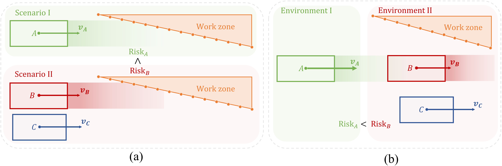
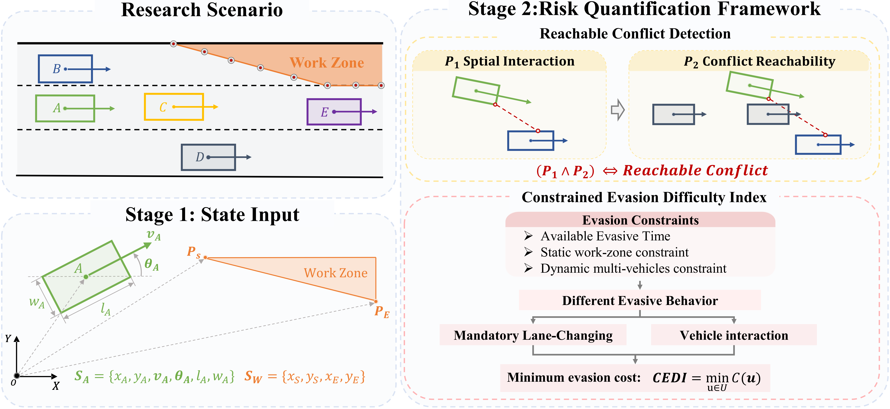
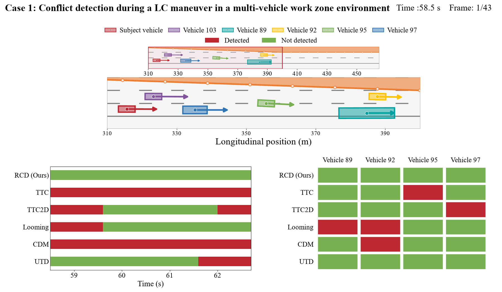
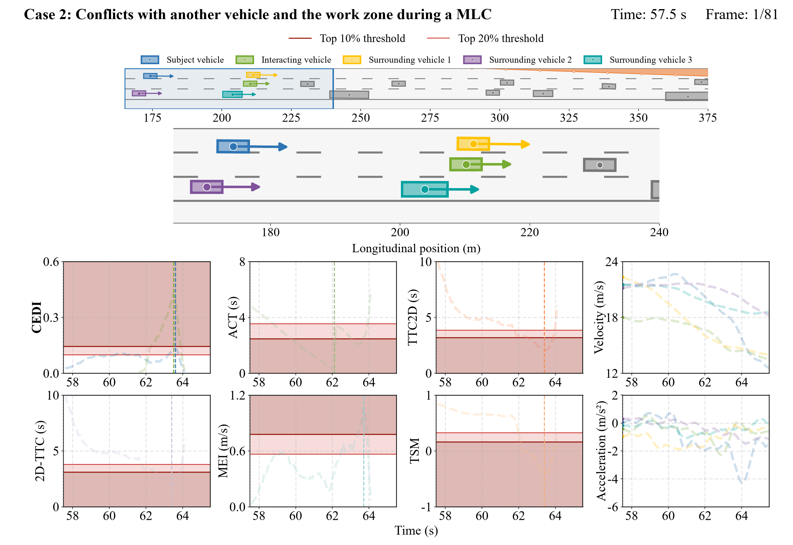

# A unified two-dimensional risk framework for highway work zone

This repository implements a unified two-dimensional framework for risk quantification in highway work zones under intensive multi-vehicle interactions. The framework integrates Reachable Conflict Detection (RCD) and the Constrained Evasion Difficulty Index (CEDI), connecting conflict detectionn with vehicle risk assessment.

RCD evaluates both spatial interaction and conflict reachability, accounting for surrounding vehicles that may obstruct a predicted conflict. CEDI quantifies the minimum evasive difficulty required for conflict resolution within the available evasion time, considering static facility constraints and the maneuvering demands of the subject vehicle and surrounding multi-vehicles. Separate formulations address Mandatory Lane-Changing (MLC) and vehicle conflicts. For vehicle conflicts, CEDI evaluates each vehicle separately, capturing asymmetric risks arising from differences in surrounding constraints and available evasive options.&#x20;

## Research motivation

### Why is it necessary to detect the reachability of conflicts ?

Consider four vehicles traveling in the same lane, ordered from rear to front as A, B, C, and D, with decreasing speeds. Pairwise prediction may identify conflicts between A and all three vehicles ahead. However, B blocks A’s direct interactions with C and D. RCD checks whether each predicted conflict is reachable, excluding interactions blocked by surrounding vehicles.

### How do surrounding conditions shape risk?

The risk faced by a vehicle depends on constraints from both static facilities and surrounding vehicles. The following examples illustrate why CEDI considers these constraints.
<p align="center">
  <a href="asset/figs/limition.pdf">
    
  </a>
</p>

<p align="left">
  <em>Figure Intensive vehicle interactions in work zones involve both static facility and multiple surrounding vehicles. Pair-based SSMs that assign a common risk value to an interacting vehicle pair can not fully capture the influence of these constraints on each vehicle’s risk.</em>
</p>

**Figure (a) Similar conflicts, different surroundings constraint**

Vehicles A and B approach the work zone in two separate scenarios. A has an open adjacent lane, while B’s lane-changing options are constrained by vehicle C. These additional constraints make conflict resolution more demanding, resulting in a higher risk for B.

**Figure (b) Different risks within the same interacting vehicle pair**

Vehicles A and B form an interacting vehicle pair but face different constraints.  A can slow down to avoid B. For B, braking may increase the risk of being struck by A, while the work zone and vehicle C restrict its lane-changing options.&#x20;

CEDI accounts for static and dynamic constraints and evaluates risk from each vehicle’s perspective, capturing both the influence of surrounding traffic and risk asymmetry within an interacting vehicle pair.

## Overview framework

[](asset/figs/framework.pdf)

The proposed 2D risk quantification framework for highway work zones comprises two stages. Stage 1 prepares vehicle state data and work zone geometry. Stage 2 quantifies risk through RCD to identify physically reachable conflicts and CEDI to evaluate risk under coupled static and dynamic mult-vehicles constraints in two conflict scenarios. Click the figure to view the full size.

## Case visualizations

Three cases from the main article illustrate conflict detection and risk evolution using historal trajectory data. The first visualization shows results from RCD and other conflict detection methods, while the second and third show risk evolution using CEDI and other safety measures. Each visualization includes the corresponding traffic scene. Two additional conflict cases are available in the [asset/gifs](asset/gifs).

### Case 1: Conflict detection during a LC maneuver in a multi-vehicle work zone environment
This case compares RCD with other conflict detection methods during an observed lane change by the subject vehicle in multi-vehicles.

[](asset/gifs/rcd_case1.gif)


### Case 2: Aggressive overtaking and MLC
This case shows how CEDI captures emerging risk and reaches the top 20% threshold earlier, providing advance warning.

[](asset/gifs/cedi_case1.gif)

### Case 3: Conflicts with another vehicle and the work zone during a MLC
This case shows how CEDI evaluates the subject and interacting vehicles separately, accounting for their respective driving environments and capturing risk asymmetry.

[](asset/gifs/cedi_case2.gif)


## Installation

Python 3.10 or later is required. Open Windows PowerShell in the `RCD_CEDI` directory and run:

```powershell
# Create a virtual environment
python -m venv .venv
# Activate the environment
.\.venv\Scripts\Activate.ps1
# Install the package and test dependencies
python -m pip install -e ".[test]"
python -m pytest -q
```

NumPy, Numba, and the test dependencies are installed automatically. The first CEDI call includes Numba compilation. Run a warm-up call before measuring execution time.

## Three example in action

Run the examples from the project root after installation. They create vehicle states directly and do not require CSV files.

| Example                  | Command | Main output |
|--------------------------|---|---|
| RCD quick-start example  | `python examples/rcd_quick.py` | Conflict status and initial contact time |
| RCD step-by-step example | `python examples/rcd_step.py` | P1, P2, ET, ALT, and obstruction results |
| MLC conflict example     | `python examples/cedi_mlc.py` | CEDI, acceleration, waiting time, and interaction demands |
| Vehicle conflict example | `python examples/cedi_vehicle.py` | CEDI and action results for each vehicle |

See [Configuration](#configuration) for adjustable settings and [Inputs and outputs](#inputs-and-outputs) for data fields.

### RCD example

Vehicle C lies between A and B. RCD checks whether C blocks their predicted conflict.

```python
from rcd_cedi import VehicleState, detect_vehicle_conflict

a = VehicleState(1, 0, 0, 10, 0, 0, 4, 2)
b = VehicleState(2, 20, 0, 0, 0, 0, 4, 2)
c = VehicleState(3, 10, 0, 0, 1, 0, 4, 2)

result = detect_vehicle_conflict(a, b, surrounding=[c])
print(result.status)       # blocked
print(result.initial_et)   # 1.6 s
print(result.blockers)     # (3,)
```
RCD combines spatial interaction (P1) and conflict reachability (P2). A potentially blocking vehicle must clear before the predicted contact: `ALT_C < ET_AB`.
### MLC example

Define the work zone and evaluate the subject vehicle. Add other vehicles through `surrounding` when needed.

```python
from rcd_cedi import VehicleState, MLCConfig, evaluate_mlc

ego = VehicleState(10, -10, 1.75, 20, 0, 0, 4.8, 2.2)
config = MLCConfig(
    zone_start=(0.0, 0.0),
    zone_end=(100.0, 3.5),
    lane_width=3.5,
    lane_origin=1.75,
    road_min_d=0.0,
    road_max_d=10.5,
    tau_steps=30,
    ax_steps=30,
)
result = evaluate_mlc(ego, surrounding=[], config=config)
print(result.status, result.cedi)
print(result.ax, result.ay)
print(result.diagnostics.get("tau_s"))  # Selected waiting time, s
```

MLC considers the waiting time, the work-zone boundary, and relevant vehicles in the original and target lanes.
### Vehicle conflict example

Evaluate the same conflict from each vehicle's perspective, including the supplied surrounding vehicles.

```python
from rcd_cedi import VehicleState, VehicleConfig, evaluate_vehicle_pair

a = VehicleState(1, 0, 1.75, 10, 0, 0, 4, 2)
b = VehicleState(2, 20, 1.75, 0, 0, 0, 4, 2)
others = [VehicleState(3, -15, 1.75, 15, 0, 0, 4, 2)]
config = VehicleConfig(
    road_min=0.0, road_max=10.5, lane_width=3.5,
    ax_steps=30, ay_steps=30, sector_steps=30,
)
results = evaluate_vehicle_pair(a, b, others, config=config)
for vid, result in results.items():
    print(vid, result.status, result.cedi)
```
First, call `detect_vehicle_conflict()` to identify reachable conflicts. Then use `evaluate_vehicle_conflict()` to assess the subject vehicle’s risk, or `evaluate_vehicle_pair()` to assess both vehicles separately.

## Configuration

### Normalization scales and sensitivity

The denominators in the CEDI cost are **normalization scales**. They can be set to finite positive values according to the scenario and assessment objective to balance sensitivity to the different maneuvering demands. They do not have to match the paper's experimental settings.

For the same action and demand, a larger normalization scale reduces that term’s cost contribution, while a smaller scale increases it. In highway and work-zone scenarios where braking is preferred to lateral evasion, the scales can be set to assign a lower relative cost to braking.

| Model | Relevant configuration fields |
|---|---|
| Vehicle conflict | `ax_accel_g`, `ax_brake_g`, `ay_g`, `surround_brake_g` |
| MLC | `ax_accel_limits_g`, `ax_brake_limits_g`, `ay_limits_g`, `surrounding_brake_limits_g` |

The `_g` suffix denotes values in units of g, converted using `g = 9.81 m/s²`. For the MLC tuples, element `[0]` is used for cost normalization. The longitudinal acceleration and braking tuples also use element `[1]` in expanded search; it is not a second cost weight.

Normalization scales, physical constraints, and search resolution have different roles. Some scale settings also affect candidate grids or search ranges, so changing them can change both the cost and the available candidates.

### Where to change parameters

Defaults are defined in [`src/rcd_cedi/config.py`](src/rcd_cedi/config.py). Override them in your own script using `MLCConfig(...)` or `VehicleConfig(...)`; fields not supplied retain their defaults. You can also use `dataclasses.replace()` to create a modified configuration.

```python
from rcd_cedi import MLCConfig, VehicleConfig

mlc_config = MLCConfig(lane_width=3.5, tau_steps=30, ax_steps=30)
vehicle_config = VehicleConfig(
    road_min=0.0, road_max=10.5, lane_width=3.5,
    ax_steps=30, ay_steps=30, sector_steps=30,
    ax_brake_g=0.75, ay_g=0.30,
)
```
## Inputs and outputs

### Vehicle states and coordinates

```python
from rcd_cedi import VehicleState

ego = VehicleState(
    vid=1,
    x=0.0, y=1.75,        # m
    vx=10.0, vy=0.0,      # m/s
    heading=0.0,          # Body heading, rad
    length=4.0, width=2.0, # m
)
```

All moving actors are rectangles with fixed body headings during prediction. Body heading and velocity direction are stored separately and need not coincide. For MLC, `x/y/vx/vy` represent longitudinal/lateral position and velocity, with lanes aligned along the x-axis.

Vehicle IDs must be unique integers. Supply only the other vehicles in `surrounding`, excluding the subject and opponent. Synchronize trajectories and convert coordinates before calling the API.

### CSV workflows

CSV processing is provided in the separate [csv_tools](csv_tools/) package. Each workflow reads trajectories, organizes synchronized scenes, performs detection and risk assessment, and exports its results automatically.

| Workflow | Entry point | Sample trajectories | Configuration |
|---|---|---|---|
| MLC | [mlc.py](csv_tools/mlc.py) | [trajectories_mlc.csv](csv_tools/data/trajectories_mlc.csv) | [mlc_config.json](csv_tools/data/mlc_config.json) |
| Vehicle conflict | [vehicle.py](csv_tools/vehicle.py) | [trajectories_vehicle.csv](csv_tools/data/trajectories_vehicle.csv) | [vehicle_config.json](csv_tools/data/vehicle_config.json) |

After installation, run from the repository root:

```powershell
# MLC: work-zone P1 detection, followed by CEDI; no P2 test
python -m csv_tools.mlc --input csv_tools/data/trajectories_mlc.csv --ego 1 --output mlc_results.csv

# Vehicle conflict: RCD P1/P2, followed by CEDI for both vehicles
python -m csv_tools.vehicle --input csv_tools/data/trajectories_vehicle.csv --ego 1 --other 2 --both --output vehicle_results.csv
```

Replace the input path and vehicle IDs for your own data. Add `--config csv_tools/data/mlc_config.json` or `--config csv_tools/data/vehicle_config.json` to override the corresponding settings. The `columns` mapping supports other CSV header names. MLC uses `zone_start` and `zone_end`; the vehicle configuration can include a convex `static_polygon`.

**MLC detection:** P1 checks predicted contact with the finite work-zone boundary under constant velocity. Positive finite contact times trigger CEDI; no contact gives 0, and initial contact remains unscored. P2 is not applied. All same-frame surrounding vehicles enter the solver.

**Vehicle conflict detection:** RCD screens pairs using P1 and P2. Only `reachable` pairs receive CEDI scores; other statuses are retained with blank scores. Omit `--both` to evaluate only the subject vehicle. 

### CSV input fields

| Field | Unit / meaning |
|---|---|
| `time_s` | Time in seconds |
| `vid` | Unique integer vehicle ID within a frame |
| `x`, `y` | Rectangle center coordinates, m |
| `vx`, `vy` | Velocity components, m/s |
| `heading` | Body heading, rad |
| `length`, `width` | Positive vehicle dimensions, m |

Coordinates and vehicle states are used as supplied: no shifting, rotation, interpolation, or rounding is performed. Provide synchronized timestamps. 

### CSV outputs

Both workflows write the selected CSV and a `<output>.config.json` file recording the effective settings.

| Fields | Meaning |
|---|---|
| `time_s`, `mode`, `subject_vehicle`, `opponent_vehicle` | Frame, workflow, and vehicle IDs; the MLC opponent is blank |
| `status`, `rcd_status` | Assessment and detection statuses |
| `p1`, `predicted_contact` | Predicted contact in the relevant model |
| `p2_checked`, `reachable` | P2 evaluation and reachability; for MLC, `p2_checked=False` and `reachable` is blank |
| `initial_et` | Initial predicted contact time, s |
| `blockers`, `unresolved_vehicles` | Vehicle-conflict RCD diagnostics; semicolon-separated IDs |
| `surrounding_count`, `surrounding_ids` | Same-frame surrounding vehicles used in evaluation |
| `cedi`, `ax`, `ay` | CEDI is dimensionless; selected acceleration components `ax` and `ay` are in m/s² |
| `front_demand`, `rear_demand` | Aggregated interaction demands, m/s² |
| `waiting_time_s` | Selected MLC waiting time, s |

Blank CEDI means unscored or unavailable, not zero risk. Detailed nested response and solver diagnostics remain available through the Python API.

### Core CEDI API status values

The vehicle CSV workflow first applies RCD screening and uses `skipped_rcd_...` with blank CEDI for unscored pairs, as explained above.

`initial_et` always refers to the initial contact forecast. The MLC remaining ET after waiting is available as `diagnostics["ET_s"]`; the vehicle conflict action duration is `diagnostics["planning_duration_s"]`.

| Status | Meaning | CEDI |
|---|---|---|
| `feasible` | The numerical search found a feasible action | Numeric value |
| `no_initial_AB_conflict` | No initial constant-velocity contact predicted for the vehicle pair | 0 |
| `no_predicted_work_zone_contact` | No MLC boundary contact predicted | 0 |
| `initial_AB_contact` | The two vehicles are initially in contact | `None` |
| `already_at_work_zone` | The MLC vehicle is initially in contact with the boundary | `None` |
| `no_feasible_action_in_expanded_search` | No feasible action found in the final vehicle conflict candidate set | `None` |
| `no_feasible_action` | No MLC action found within the finite search budget | `None` |
| `initial_SV_work_zone_overlap` | The subject vehicle initially overlaps the static constraint | `None` |
| `initial_SV_road_boundary_violation` | The subject vehicle initially violates the road bounds | `None` |

Failure to find an action in a finite search is not proof of physical infeasibility in continuous control space.

## Source code responsibilities

The modules below are located in `src/rcd_cedi/`.

| Module | Responsibility |
|---|---|
| `models.py` / `config.py` | Shared vehicle states, result objects, and model settings |
| `geometry.py` / `rcd.py` | Rectangle geometry, spatial interaction, and reachability |
| `motion.py` | Piecewise motion and continuous constraint checks |
| `static.py` | Static convex polygons, scene packing, and initial overlap checks |
| `search.py` / `responses.py` | Candidate actions and surrounding-vehicle responses |
| `cedi/mlc.py` / `cedi/vehicle.py` | MLC and vehicle conflict CEDI solvers |
| `audit.py` | Independent action checks and terminal-motion audits |
| `api.py` / `__init__.py` | Public interfaces |

## Citation
```yaml
cff-version: 1.2.0
message: "Please cite the software version used and the accompanying RCD-CEDI manuscript."
type: software
title: "RCD-CEDI: Reachable Conflict Detection and Constrained Evasion Difficulty Index"
authors:
  - family-names: Li
    given-names: Jiaxin
version: 0.1.1
repository-code: "https://github.com/JiaxinTrans/RCD_CEDI"
```

## License

This project is licensed under the MIT License.
See [LICENSE](LICENSE) for details.